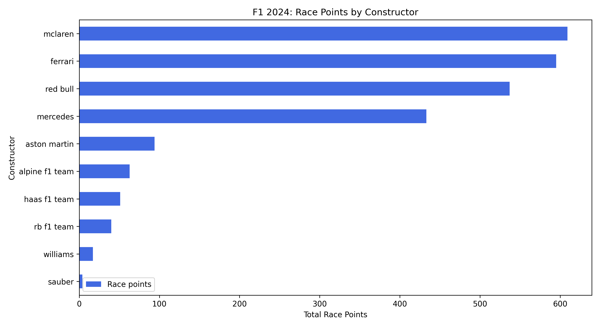
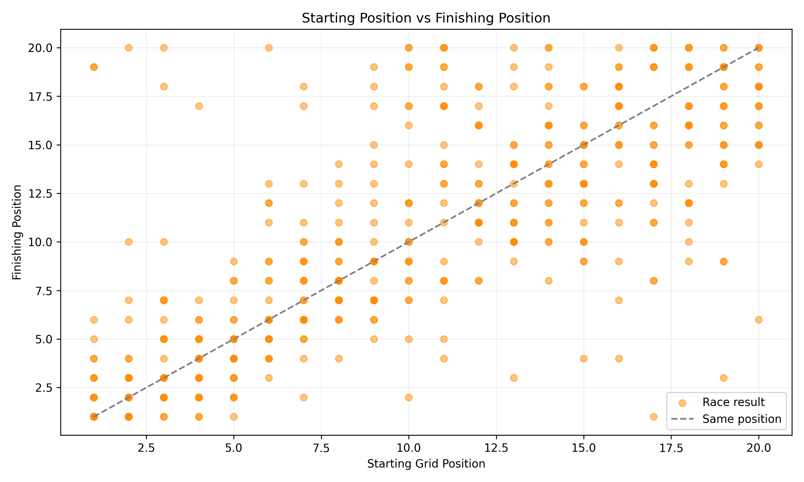
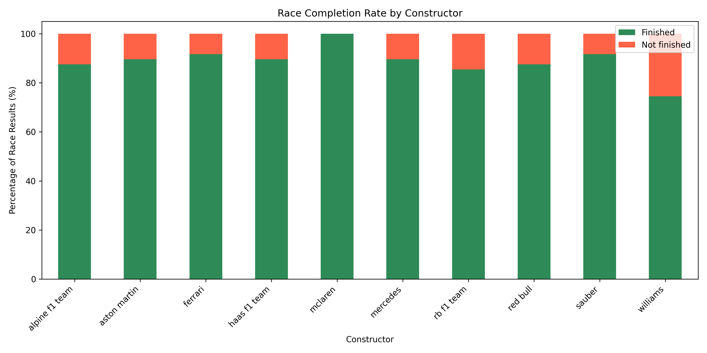

# F1 2024 Data Pipeline — SIS 2

## 1. Project Overview

This project was developed for the Data Collection and
Preparation course at Kazakh-British Technical University.

The main objective is to build a complete automated data
pipeline using real Formula 1 race results from the 2024
season.

The pipeline includes:

- REST API data collection
- JSON parsing and pagination
- Apache Kafka data transmission
- Pandera data validation
- Data cleaning and transformation
- SQLite database storage
- Exploratory Data Analysis (EDA)
- Data visualization
- Pipeline testing and verification

## 2. Team Members

| Full Name | Student ID | Project Area |
|---|---|---|
| Jumabay Zhanerke | 24B031732 | API, Pandera and integration |
| Duman Symbat | 24B031736 | Data Cleaning, SQLite and EDA |
| Madina Nurmagambetova | 23B031872 | Apache Kafka |

The project areas represent the team's assigned responsibilities.

## 3. Technologies

| Technology | Purpose |
|---|---|
| Python 3.9.6 | Main programming language |
| Requests | REST API requests |
| Apache Kafka 3.9.0 | Data transmission |
| Docker | Kafka broker environment |
| kafka-python | Kafka producer and consumer |
| Pandera | Data quality validation |
| Pandas | Data processing and analysis |
| NumPy | Numerical transformations |
| SQLite3 | Database storage |
| Matplotlib | Data visualization |
| Git and GitHub | Version control |

## 4. Data Source

The project uses the public Jolpica F1 REST API.

API endpoint:

https://api.jolpi.ca/ergast/f1/2024/results.json

Request parameters:

- Season: 2024
- Limit: 30 records per request
- Offset: pagination parameter
- Request timeout: 30 seconds
- Delay between requests: 0.5 seconds
- Maximum attempts for HTTP 429: 3

No API key is required.

The API returns nested JSON data, which is converted into
a structured CSV dataset.

### Dataset Information

| Metric | Value |
|---|---:|
| API pages | 16 |
| Original records | 479 |
| Original columns | 17 |
| Processed columns | 19 |
| Races | 24 |
| Drivers | 24 |
| Constructors | 10 |
| Countries | 21 |

The dataset contains main-race results only.
Sprint race points are not included.

## 5. Pipeline Architecture

```text
Jolpica F1 REST API
        |
        v
API Data Collection
        |
        v
raw_data.csv
        |
        v
Kafka Producer
        |
        v
Apache Kafka Broker
Topic: f1_race_results
        |
        v
Kafka Consumer
        |
        v
consumed_records.csv
        |
        v
Pandera Validation
        |
        +----> invalid_records.csv
        |
        v
valid_records.csv
        |
        v
Pandas and NumPy Cleaning
        |
        v
processed_data.csv
        |
        v
SQLite Database
        |
        v
Exploratory Data Analysis
        |
        v
Statistics and Visualizations
```

The main.py file integrates all components and controls
the execution order.

EDA reads the processed CSV after database loading.

## 6. Project Structure

```text
F1-SIS2-Data-Pipeline/
|
|-- data/
|   |-- raw_data.csv
|   |-- consumed_records.csv
|   |-- valid_records.csv
|   |-- invalid_records.csv
|   |-- processed_data.csv
|   |-- driver_points_pivot.csv
|   |-- team_statistics.csv
|   |-- output.db
|
|-- src/
|   |-- config.py
|   |-- api_client.py
|   |-- producer.py
|   |-- consumer.py
|   |-- validator.py
|   |-- cleaner.py
|   |-- loader.py
|   |-- analysis.py
|
|-- figures/
|   |-- 01_team_points.png
|   |-- 02_grid_vs_position.png
|   |-- 03_finish_rate.png
|
|-- docs/
|   |-- data_dictionary.md
|
|-- report/
|   |-- project_report.pdf
|
|-- main.py
|-- requirements.txt
|-- README.md
|-- .gitignore
```

## 7. Installation and Environment Setup

### Software Requirements

- Python 3.9.6 or a compatible Python environment
- Docker Desktop or Docker Engine
- Git
- SQLite command-line tool for manual database verification
- Internet connection for API requests

### Step 1. Clone the Repository

```bash
git clone https://github.com/zhanerke0613/F1-SIS2-Data-Pipeline.git
cd F1-SIS2-Data-Pipeline
```

### Step 2. Create a Virtual Environment

```bash
python3 -m venv .venv
```

Activate the environment on macOS or Linux:

```bash
source .venv/bin/activate
```

On Windows PowerShell:

```powershell
.venv\Scripts\Activate.ps1
```

### Step 3. Install Dependencies

```bash
python -m pip install --upgrade pip
python -m pip install -r requirements.txt
```

Verify the installation:

```bash
python -m pip check
python --version
```

Expected dependency check result:

```text
No broken requirements found.
```

All 32 pinned dependencies were successfully installed
and verified in a clean Python 3.9.6 virtual environment.

## 8. Apache Kafka Setup

### Step 1. Start Docker

Make sure Docker is running.

Download the Kafka image:

```bash
docker pull apache/kafka:3.9.0
```

### Step 2. Start the Kafka Broker

```bash
docker run -d --name kafka \
  -p 127.0.0.1:9092:9092 \
  apache/kafka:3.9.0
```

If the container already exists but is stopped:

```bash
docker start kafka
```

Verify that Kafka is running:

```bash
docker ps
```

### Step 3. Create the Kafka Topic

```bash
docker exec kafka /opt/kafka/bin/kafka-topics.sh \
  --create \
  --topic f1_race_results \
  --bootstrap-server localhost:9092 \
  --partitions 1 \
  --replication-factor 1
```

List available topics:

```bash
docker exec kafka /opt/kafka/bin/kafka-topics.sh \
  --list \
  --bootstrap-server localhost:9092
```

Kafka configuration:

| Parameter | Value |
|---|---|
| Bootstrap server | localhost:9092 |
| Topic | f1_race_results |
| Partitions | 1 |
| Replication factor | 1 |
| Message format | JSON |

### Step 4. Reset the Topic Before a New Run

The consumer reads messages from the earliest offset.
Therefore, a clean topic is required to avoid stale messages.

Delete the existing local project topic:

```bash
docker exec kafka /opt/kafka/bin/kafka-topics.sh \
  --delete \
  --topic f1_race_results \
  --bootstrap-server localhost:9092
```

Wait until the topic is deleted, then recreate it:

```bash
docker exec kafka /opt/kafka/bin/kafka-topics.sh \
  --create \
  --topic f1_race_results \
  --bootstrap-server localhost:9092 \
  --partitions 1 \
  --replication-factor 1
```

Warning: deleting the topic removes its existing messages.
Use this procedure only for the local project topic.

## 9. Running the Complete Pipeline

Activate the virtual environment and make sure Kafka
is running with a clean project topic.

Run the following command from the project root:

```bash
python main.py
```

The pipeline automatically executes:

1. API data collection
2. Kafka Producer
3. Kafka Consumer
4. Pandera validation
5. Data cleaning and transformation
6. SQLite database loading
7. Database idempotency test
8. Exploratory Data Analysis

The program also compares the original and consumed
datasets to verify data integrity.

### Expected Pipeline Summary

```text
==================================================
PIPELINE SUMMARY
==================================================
API records: 479
Kafka sent: 479
Kafka received: 479
Valid records: 479
Invalid records: 3
Idempotency test: PASSED
Processed records: 479
Database records: 479
Charts generated: 3

Pipeline completed successfully!
```

## 10. Running Individual Components

All commands must be executed from the project root
with the virtual environment activated.

### API Data Collection

```bash
python -m src.api_client
```

Output:

```text
data/raw_data.csv
```

### Kafka Producer

```bash
python -m src.producer
```

The producer reads raw_data.csv, converts records into
JSON messages and sends them to the Kafka topic.

Expected number of sent records: 479.

### Kafka Consumer

```bash
python -m src.consumer
```

The consumer receives Kafka messages, checks their
structure, removes duplicate keys and saves the results.

Output:

```text
data/consumed_records.csv
```

Expected number of received records: 479.

### Pandera Validation

To validate the original API dataset independently:

```bash
python -m src.validator
```

To validate the consumed Kafka dataset as part of
the complete pipeline:

```bash
python -c "from src.validator import validate_data; validate_data('data/consumed_records.csv')"
```

Outputs:

```text
data/valid_records.csv
data/invalid_records.csv
```

### Data Cleaning

```bash
python -m src.cleaner
```

Outputs:

```text
data/processed_data.csv
data/driver_points_pivot.csv
```

### SQLite Database Loading

```bash
python -m src.loader
```

Output:

```text
data/output.db
```

### Exploratory Data Analysis

```bash
python -m src.analysis
```

Outputs:

```text
data/team_statistics.csv
figures/01_team_points.png
figures/02_grid_vs_position.png
figures/03_finish_rate.png
```

## 11. Data Validation with Pandera

Pandera is used to validate data quality before cleaning.

The schema checks:

| Field | Validation Rule |
|---|---|
| season | Must match the configured season |
| round | Between 1 and 24 |
| driver_id | Nonempty string |
| constructor_id | Nonempty string |
| points | Between 0 and 26 |
| grid | Between 0 and 30 |
| laps | Greater than or equal to zero |
| race_date | Within the configured season |
| Composite key | Must be unique |

Three intentionally invalid test records are added
to verify that the validation rules work correctly.

| Test | Invalid Value | Result |
|---|---|---|
| Negative points | -10 | Detected |
| Incorrect date | 2025-01-01 | Detected |
| Empty driver ID | Empty string | Detected |

### Validation Results

| Metric | Count |
|---|---:|
| Original records | 479 |
| Test records | 3 |
| Total checked records | 482 |
| Valid records | 479 |
| Invalid records | 3 |

All three invalid test records were detected and
excluded from the processed dataset.

## 12. Data Cleaning and Transformation

Pandas and NumPy are used to prepare the data for analysis.

The cleaning process includes:

- Missing value detection
- Duplicate removal
- Data type conversion
- Date conversion
- Text normalization
- Filtering using multiple conditions
- Creation of derived columns
- GroupBy operations
- Pivot table generation

### Missing Values

| Column | Missing Values | Handling |
|---|---:|---|
| race_time_ms | 47 | Preserve null values |
| fastest_lap_time | 17 | Preserve null values |
| positions_gained | 1 | Preserve null for grid = 0 |

Missing timing values are preserved because replacing
them with artificial values could affect the analysis.

### Derived Columns

#### finished

Indicates whether the driver completed the race
according to the project definition.

```python
df["finished"] = np.where(
    df["status"].isin(["finished", "lapped"]),
    1,
    0
)
```

#### positions_gained

Calculates the difference between starting and
finishing positions.

```python
df["positions_gained"] = np.where(
    df["grid"] > 0,
    df["grid"] - df["position"],
    np.nan
)
```

### Transformation Results

| Metric | Before | After |
|---|---:|---:|
| Records | 479 | 479 |
| Columns | 17 | 19 |
| Derived columns | 0 | 2 |

No original records were lost during cleaning.

## 13. SQLite Database

The processed dataset is stored in:

```text
data/output.db
```

Database table:

```text
race_results
```

The table contains 19 columns.

A composite primary key prevents duplicate race results:

```sql
PRIMARY KEY (season, round, driver_id)
```

The loader uses parameterized INSERT OR IGNORE statements.

This allows the same dataset to be loaded multiple times
without inserting duplicate records.

## 14. Database Idempotency Testing

The main pipeline automatically executes the database
loader twice.

The test can also be performed manually:

```bash
python -m src.loader
python -m src.loader
```

Expected result on the second execution:

```text
Processed records: 479
Database records before: 479
New records inserted: 0
Database records after: 479
Duplicate records: 0
Data count matches: True
```

### Observed Results

| Metric | First Load | Second Load |
|---|---:|---:|
| Records before | 0 | 479 |
| New records inserted | 479 | 0 |
| Records after | 479 | 479 |
| Duplicate records | 0 | 0 |

The first-load results were obtained using a fresh database.

The idempotency test passed successfully.

Note: INSERT OR IGNORE prevents duplicate inserts but
does not update existing records when their values change.

## 15. SQLite Database Verification

Open the database:

```bash
sqlite3 data/output.db
```

### Query 1. Verify Total Records

```sql
SELECT COUNT(*) FROM race_results;
```

Expected result:

```text
479
```

### Query 2. Check Duplicate Records

```sql
SELECT season, round, driver_id, COUNT(*)
FROM race_results
GROUP BY season, round, driver_id
HAVING COUNT(*) > 1;
```

Expected result: no rows returned.

### Query 3. Calculate Points by Constructor

```sql
SELECT constructor_name,
       SUM(points) AS total_points
FROM race_results
GROUP BY constructor_name
ORDER BY total_points DESC;
```

### Query 4. Check Race Completion

```sql
SELECT finished, COUNT(*)
FROM race_results
GROUP BY finished;
```

Expected result:

```text
0|54
1|425
```

### Query 5. Inspect Database Structure

```sql
PRAGMA table_info(race_results);
```

Exit SQLite:

```text
.exit
```

## 16. Exploratory Data Analysis

The analysis module performs:

- Descriptive numerical statistics
- Categorical statistics
- Constructor performance analysis
- Average finishing position analysis
- Race completion analysis
- Data visualization

### General Statistics

| Metric | Value |
|---|---:|
| Total records | 479 |
| Total columns | 19 |
| Mean points | 5.10 |
| Mean laps | 55.42 |
| Mean finishing position | 10.48 |
| Completed race records | 425 |
| Other race records | 54 |
| Overall completion rate | 88.73% |

### Figure 1. Race Points by Constructor



McLaren recorded the highest number of main-race points,
followed by Ferrari and Red Bull.

| Constructor | Race Points |
|---|---:|
| McLaren | 609 |
| Ferrari | 595 |
| Red Bull | 537 |
| Mercedes | 433 |
| Aston Martin | 94 |
| Alpine F1 Team | 63 |
| Haas F1 Team | 51 |
| RB F1 Team | 40 |
| Williams | 17 |
| Sauber | 4 |

Sprint points are excluded from these totals.

### Figure 2. Starting vs Finishing Position



The scatter plot compares starting grid positions
with finishing positions.

The diagonal represents no change in position.

Points below the diagonal represent positions gained.
Points above the diagonal represent positions lost.

Drivers who start near the front often finish in
better positions, although individual results vary.

### Figure 3. Race Completion Rate



McLaren achieved a 100% completion rate across
48 recorded race entries.

Williams recorded the lowest completion rate
at approximately 74.47%.

The overall completion rate was 88.73%.

### Race Status Distribution

| Status | Records |
|---|---:|
| Finished | 287 |
| Lapped | 138 |
| Retired | 49 |
| Did not start | 3 |
| Disqualified | 2 |
| Total | 479 |

Finished and lapped records are classified as
completed races in this project.

## 17. Season Configuration

The season parameter is defined in:

```text
src/config.py
```

```python
SEASON = 2024
```

This shared constant is used by:

- API endpoint configuration
- Pandera season validation
- Pandera date validation
- Data cleaning filters
- Chart title
- Main pipeline title

To collect data for another season, modify the constant.

Before running another season:

1. Reset the local Kafka topic.
2. Back up the existing database.
3. Use a fresh database.
4. Review season-specific validation rules.
5. Run the complete pipeline again.

Other seasons may have different race counts,
scoring systems and status formats.

The current project has been tested for the 2024 season.

## 18. Pipeline Testing and Verification

The final integrated pipeline was successfully executed
after correcting the race completion flag and adding
automatic idempotency testing.

The test was performed in a clean virtual environment
using Python 3.9.6 and a running Apache Kafka broker.

### Final Test Results

| Test | Result | Status |
|---|---|---|
| Dependency installation | 32 packages installed | PASSED |
| pip check | No broken requirements | PASSED |
| Python syntax compilation | No syntax errors | PASSED |
| API collection | 479 records | PASSED |
| Kafka Producer | 479 messages | PASSED |
| Kafka Consumer | 479 messages | PASSED |
| Source and consumed data comparison | Matching datasets | PASSED |
| Skipped Kafka messages | 0 | PASSED |
| Duplicate Kafka messages | 0 | PASSED |
| Pandera validation | 3 invalid test records detected | PASSED |
| Data cleaning | 479 records, 19 columns | PASSED |
| SQLite storage | 479 records | PASSED |
| Database duplicate check | 0 duplicates | PASSED |
| Database idempotency | 0 new records on second load | PASSED |
| EDA | 3 charts generated | PASSED |

The final execution completed successfully.

Non-blocking LibreSSL, Pandera and Kafka serializer
warnings were observed during execution.

API error-handling branches are implemented, but deliberate
network failure tests were not performed.

## 19. Expected Output Files

| File | Description |
|---|---|
| raw_data.csv | Original API dataset |
| consumed_records.csv | Data received from Kafka |
| valid_records.csv | Validated records |
| invalid_records.csv | Rejected records and error reasons |
| processed_data.csv | Cleaned analytical dataset |
| driver_points_pivot.csv | Driver points by race round |
| team_statistics.csv | Constructor performance statistics |
| output.db | SQLite database |
| 01_team_points.png | Constructor points chart |
| 02_grid_vs_position.png | Starting and finishing position chart |
| 03_finish_rate.png | Race completion chart |
| data_dictionary.md | Dataset field descriptions |
| project_report.pdf | Final project report |

## 20. Project Limitations

- The dataset covers one Formula 1 season.
- Sprint race points are excluded.
- Some race timing values are missing.
- Kafka uses a single broker and one partition.
- The local Kafka topic must be reset before repeated runs.
- SQLite INSERT OR IGNORE does not update existing records.
- Other seasons may require changes to validation rules.

## 21. Conclusion

This project demonstrates a complete automated data
pipeline using real Formula 1 race results.

The pipeline successfully collected, transmitted,
validated, cleaned, stored and analyzed 479 records.

All three intentionally invalid test records were detected.

The final SQLite database contains 479 unique records
with zero duplicates.

Repeated database loading confirmed idempotency.

Three visualizations were generated to analyze constructor
performance, starting and finishing positions, and
race completion rates.

The project was successfully tested in a clean Python
environment and can be executed using one command:

```bash
python main.py
```

## 22. References

- Jolpica F1 API: https://api.jolpi.ca/ergast/f1/2024/results.json
- Apache Kafka: https://kafka.apache.org/documentation/
- Pandera: https://pandera.readthedocs.io/
- Pandas: https://pandas.pydata.org/docs/
- NumPy: https://numpy.org/doc/
- SQLite3: https://docs.python.org/3/library/sqlite3.html
- Matplotlib: https://matplotlib.org/stable/
- Docker: https://docs.docker.com/

## 23. GitHub Repository

https://github.com/zhanerke0613/F1-SIS2-Data-Pipeline

Kazakh-British Technical University

Data Collection and Preparation — SIS 2

2026